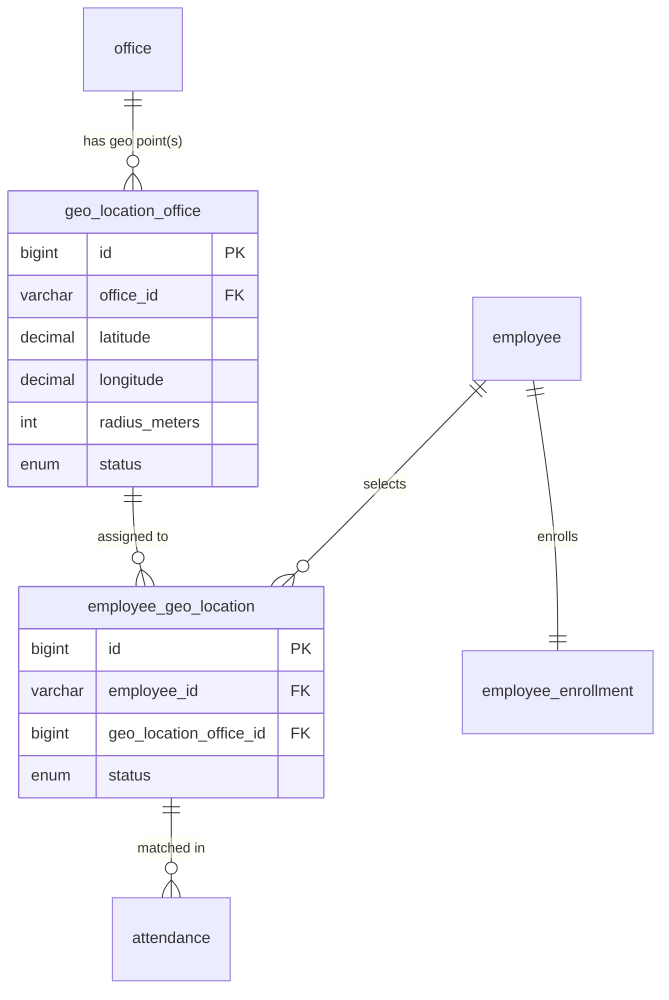
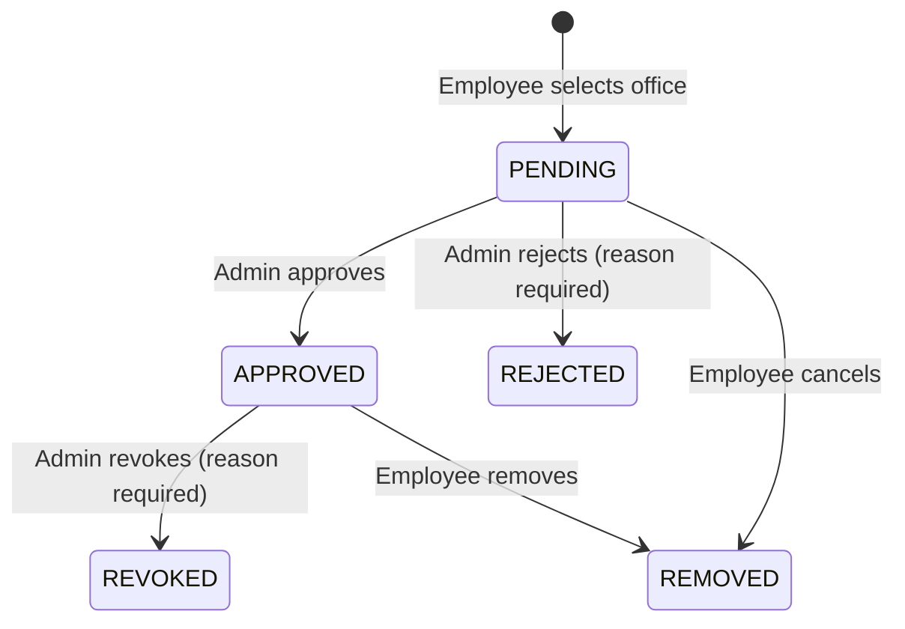
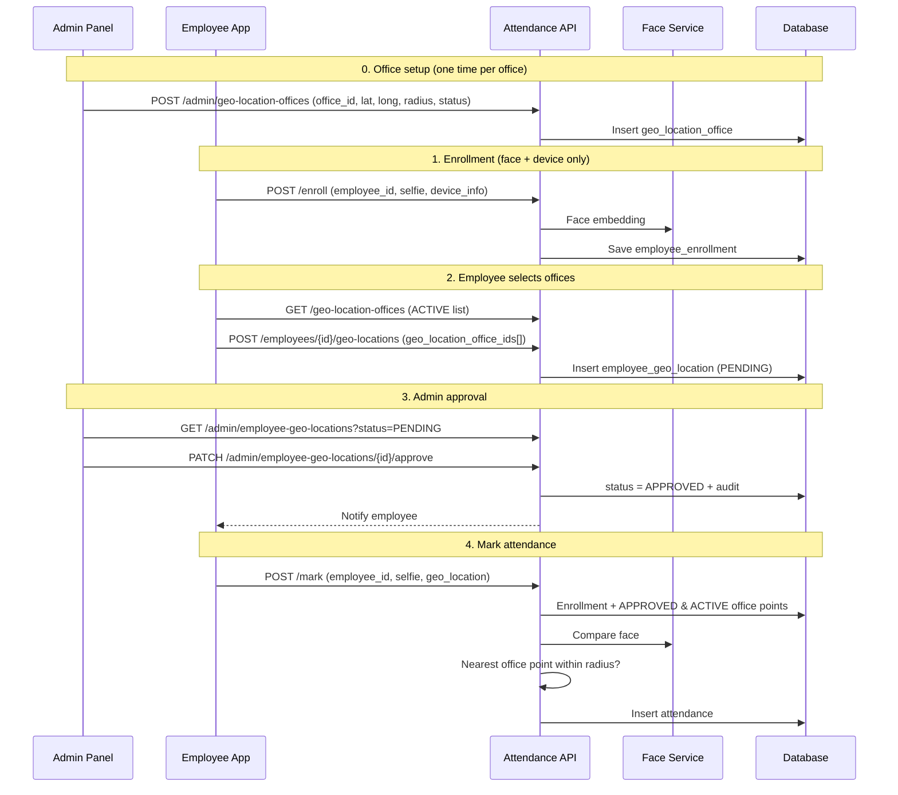

# Employee Attendance with Face Recognition

## 1. Overview

Attendance is marked by verifying the employee's **face** and **location**.

- **Face** is matched against the selfie captured during **Enrollment**.
- **Location** is matched against **office geo-locations**. Admin sets the latitude/longitude of each office in `geo_location_office`. An employee does **not** type coordinates; they **select one or more offices**, and each selection is stored in `employee_geo_location` and must be **approved by an Admin**.
- **Enrollment does not take any geo-location.** It saves only face and device.

| # | API Group | Who | Purpose |
|---|-----------|-----|---------|
| 1 | **Office Geo-Location Setup** | Admin | Set lat/long, radius and status of each office (`geo_location_office`) |
| 2 | **Enrollment** | Employee | Register selfie and device only |
| 3 | **Employee Office Selection** | Employee | Pick one or more offices (`employee_geo_location`, status `PENDING`) |
| 4 | **Approval** | Admin | Approve / reject / revoke an employee's office |
| 5 | **Mark Attendance** | Employee | Selfie + current location matched with enrolled face and any **APPROVED** office |

> **Core rule:** Attendance is marked **only if** the selfie matches the enrolled face **and** the current location is inside the radius of at least one office that is **ACTIVE** in `geo_location_office` and **APPROVED** for that employee in `employee_geo_location`.

---

## 2. Database Design

### 2.1 Relationship



One office can have **more than one geo point** (e.g. two buildings on one campus). That is why `geo_location_office.id` is separate from `office_id`, and `employee_geo_location` links to `geo_location_office.id`.

### 2.2 `geo_location_office`

| Column | Type | Notes |
|--------|------|-------|
| `id` | BIGINT PK | Auto increment |
| `office_id` | VARCHAR(50) | FK → `office.office_id` |
| `latitude` | DECIMAL(10,7) | Geo location lat |
| `longitude` | DECIMAL(10,7) | Geo location long |
| `radius_meters` | INT | *Added:* allowed distance for attendance, default 100 |
| `status` | ENUM('ACTIVE','INACTIVE') | Only `ACTIVE` points are used |
| `created_by` | VARCHAR(50) | Admin ID |
| `created_at`, `updated_at` | DATETIME | |

Index: `(office_id, status)`.

### 2.3 `employee_geo_location`

| Column | Type | Notes |
|--------|------|-------|
| `id` | BIGINT PK | Auto increment |
| `employee_id` | VARCHAR(50) | FK → `employee.employee_id` |
| `geo_location_office_id` | BIGINT | FK → **`geo_location_office.id`** |
| `status` | ENUM('PENDING','APPROVED','REJECTED','REVOKED','REMOVED') | *Added for admin approval* |
| `requested_at` | DATETIME | |
| `reviewed_by` | VARCHAR(50) NULL | Admin ID |
| `reviewed_at` | DATETIME NULL | |
| `review_note` | VARCHAR(255) NULL | Reject / revoke reason |

Unique: `(employee_id, geo_location_office_id)`. Index: `(employee_id, status)`.

> `id`, `employee_id` and `geo_location_office_id` are the core fields. `status` and the review columns are needed for the admin approval flow; without them every selection would be active immediately.

### 2.4 Other tables

**`employee_enrollment`**: `id`, `enrollment_id`, `employee_id` (unique), `selfie_image_path`, `face_embedding` (encrypted), `device_id`, `device_info` (JSON), `status`, `created_at`, `updated_at`. No location columns.

**`attendance`**: `id`, `attendance_id`, `employee_id`, **`employee_geo_location_id`**, **`geo_location_office_id`**, `type` (CHECK_IN / CHECK_OUT), `selfie_image_path`, `face_similarity_score`, `latitude`, `longitude`, `distance_meters`, `device_id`, `marked_at` (server time).

**`employee_geo_location_audit`**: `id`, `employee_geo_location_id`, `admin_id`, `action` (APPROVE / REJECT / REVOKE), `old_status`, `new_status`, `note`, `created_at`.

**`attendance_attempt_log`**: `id`, `employee_id`, `result`, `failure_code`, `face_similarity_score`, `nearest_geo_location_office_id`, `distance_meters`, `created_at`.

### 2.5 DDL (MySQL)

```sql
CREATE TABLE geo_location_office (
  id             BIGINT AUTO_INCREMENT PRIMARY KEY,
  office_id      VARCHAR(50)   NOT NULL,
  latitude       DECIMAL(10,7) NOT NULL,
  longitude      DECIMAL(10,7) NOT NULL,
  radius_meters  INT           NOT NULL DEFAULT 100,
  status         ENUM('ACTIVE','INACTIVE') NOT NULL DEFAULT 'ACTIVE',
  created_by     VARCHAR(50),
  created_at     DATETIME DEFAULT CURRENT_TIMESTAMP,
  updated_at     DATETIME DEFAULT CURRENT_TIMESTAMP ON UPDATE CURRENT_TIMESTAMP,
  INDEX idx_office_status (office_id, status),
  CONSTRAINT fk_glo_office FOREIGN KEY (office_id) REFERENCES office(office_id)
);

CREATE TABLE employee_geo_location (
  id                      BIGINT AUTO_INCREMENT PRIMARY KEY,
  employee_id             VARCHAR(50) NOT NULL,
  geo_location_office_id  BIGINT      NOT NULL,
  status        ENUM('PENDING','APPROVED','REJECTED','REVOKED','REMOVED') NOT NULL DEFAULT 'PENDING',
  requested_at  DATETIME DEFAULT CURRENT_TIMESTAMP,
  reviewed_by   VARCHAR(50),
  reviewed_at   DATETIME,
  review_note   VARCHAR(255),
  UNIQUE KEY uq_emp_geo (employee_id, geo_location_office_id),
  INDEX idx_emp_status (employee_id, status),
  CONSTRAINT fk_egl_employee FOREIGN KEY (employee_id) REFERENCES employee(employee_id),
  CONSTRAINT fk_egl_geo FOREIGN KEY (geo_location_office_id) REFERENCES geo_location_office(id)
);
```

---

## 3. Status Rules

**`geo_location_office.status`** (set by Admin)

| Status | Meaning |
|--------|---------|
| `ACTIVE` | Shown to employees for selection and used for attendance |
| `INACTIVE` | Hidden from selection; attendance at this point is blocked for everyone, even if their selection is APPROVED |

**`employee_geo_location.status`**



- An employee can select **multiple offices** (max 5 active by default).
- The same office cannot be selected twice while active (unique key). A REJECTED / REMOVED row can be set back to PENDING if the employee selects it again.
- Employee with **no APPROVED office** cannot mark attendance (`NO_APPROVED_LOCATION`).

---

## 4. System Flow



---

## 5. Admin: Office Geo-Location APIs (`geo_location_office`)

### 5.1 Create

```
POST /api/v1/admin/geo-location-offices
```

```json
{
  "office_id": "OFF-UTT",
  "latitude": 23.8759,
  "longitude": 90.3795,
  "radius_meters": 120,
  "status": "ACTIVE"
}
```

**Response `201`**

```json
{ "status": "success", "data": { "id": 4, "office_id": "OFF-UTT", "status": "ACTIVE" } }
```

Validation: `office_id` exists in `office`; lat −90..90; long −180..180; radius 30–1000.

### 5.2 List

```
GET /api/v1/admin/geo-location-offices?office_id=OFF-UTT&status=ACTIVE
```

```json
{
  "status": "success",
  "data": [
    {
      "id": 4,
      "office_id": "OFF-UTT",
      "office_name": "Uttara Branch",
      "latitude": 23.8759,
      "longitude": 90.3795,
      "radius_meters": 120,
      "status": "ACTIVE",
      "approved_employees": 18
    }
  ]
}
```

### 5.3 Update

```
PUT /api/v1/admin/geo-location-offices/{id}
```

Body: any of `latitude`, `longitude`, `radius_meters`. Changing coordinates affects all employees linked to this point, so the UI asks for confirmation.

### 5.4 Activate / deactivate

```
PATCH /api/v1/admin/geo-location-offices/{id}/status
```

```json
{ "status": "INACTIVE" }
```

---

## 6. Enrollment API

```
POST /api/v1/attendance/enroll
Content-Type: multipart/form-data
```

| Field | Type | Required | Description |
|-------|------|----------|-------------|
| `employee_id` | string | Yes | Unique employee ID |
| `employee_selfie_image` | file | Yes | Front-facing selfie (max 5 MB) |
| `device_info` | JSON string | Yes | `device_id`, `device_model`, `os`, `os_version`, `app_version` |

No geo-location here. Processing: validate employee → not already enrolled → one face + liveness → embedding → save.

**Response `201`**

```json
{
  "status": "success",
  "message": "Employee enrolled. Select your office to start marking attendance.",
  "data": {
    "employee_id": "EMP1001",
    "enrollment_id": "ENR-20261104-0001",
    "next_step": "SELECT_OFFICE"
  }
}
```

| HTTP | Code | Reason |
|------|------|--------|
| 400 | `INVALID_INPUT` | Missing / malformed field |
| 404 | `EMPLOYEE_NOT_FOUND` | Not in employee master |
| 409 | `ALREADY_ENROLLED` | Already enrolled |
| 422 | `NO_FACE_DETECTED` / `MULTIPLE_FACES` / `LOW_IMAGE_QUALITY` / `LIVENESS_FAILED` | Image problems |

---

## 7. Employee: Office Selection APIs (`employee_geo_location`)

### 7.1 Offices available to select

```
GET /api/v1/geo-location-offices
```

Returns only `ACTIVE` rows of `geo_location_office`, with office name.

```json
{
  "status": "success",
  "data": [
    { "id": 1, "office_id": "OFF-HQ",  "office_name": "Head Office, Gulshan", "latitude": 23.7925, "longitude": 90.4078, "radius_meters": 100 },
    { "id": 4, "office_id": "OFF-UTT", "office_name": "Uttara Branch",        "latitude": 23.8759, "longitude": 90.3795, "radius_meters": 120 },
    { "id": 6, "office_id": "OFF-CTG", "office_name": "Chattogram Warehouse", "latitude": 22.3569, "longitude": 91.7832, "radius_meters": 200 }
  ]
}
```

### 7.2 Select offices (multiple)

```
POST /api/v1/employees/{employee_id}/geo-locations
```

```json
{ "geo_location_office_ids": [1, 4] }
```

**Response `201`**

```json
{
  "status": "success",
  "message": "Office selection sent for admin approval",
  "data": [
    { "id": 101, "employee_id": "EMP1001", "geo_location_office_id": 1, "status": "PENDING" },
    { "id": 102, "employee_id": "EMP1001", "geo_location_office_id": 4, "status": "PENDING" }
  ]
}
```

| HTTP | Code | Reason |
|------|------|--------|
| 404 | `NOT_ENROLLED` | Enroll first |
| 404 | `GEO_LOCATION_OFFICE_NOT_FOUND` | Wrong id or INACTIVE |
| 409 | `ALREADY_SELECTED` | Already PENDING / APPROVED |
| 422 | `LOCATION_LIMIT_EXCEEDED` | More than max active |

### 7.3 My offices

```
GET /api/v1/employees/{employee_id}/geo-locations
```

```json
{
  "status": "success",
  "data": [
    { "id": 101, "geo_location_office_id": 1, "office_name": "Head Office, Gulshan", "status": "APPROVED" },
    { "id": 102, "geo_location_office_id": 4, "office_name": "Uttara Branch", "status": "PENDING" }
  ]
}
```

### 7.4 Remove / cancel

```
DELETE /api/v1/employees/{employee_id}/geo-locations/{id}
```

Sets `status = REMOVED`.

---

## 8. Admin: Approval APIs

### 8.1 List requests

```
GET /api/v1/admin/employee-geo-locations?status=PENDING&office_id=OFF-UTT&search=EMP10&page=1
```

```json
{
  "status": "success",
  "data": {
    "items": [
      {
        "id": 102,
        "employee_id": "EMP1001",
        "employee_name": "Rahim Uddin",
        "department": "Sales",
        "geo_location_office_id": 4,
        "office_id": "OFF-UTT",
        "office_name": "Uttara Branch",
        "latitude": 23.8759,
        "longitude": 90.3795,
        "radius_meters": 120,
        "status": "PENDING",
        "requested_at": "2026-11-04T09:16:00+06:00"
      }
    ],
    "total": 1
  }
}
```

### 8.2 Approve / Reject / Revoke

```
PATCH /api/v1/admin/employee-geo-locations/{id}/approve    body: { "note": "optional" }
PATCH /api/v1/admin/employee-geo-locations/{id}/reject     body: { "reason": "required" }
PATCH /api/v1/admin/employee-geo-locations/{id}/revoke     body: { "reason": "required" }
```

### 8.3 Bulk

```
POST /api/v1/admin/employee-geo-locations/bulk-review
```

```json
{ "action": "APPROVE", "ids": [102, 107, 111], "note": "Branch staff" }
```

### 8.4 Direct assign (optional)

Admin can assign an office to an employee directly, created as `APPROVED`:

```
POST /api/v1/admin/employee-geo-locations
{ "employee_id": "EMP1300", "geo_location_office_id": 4 }
```

| HTTP | Code | Reason |
|------|------|--------|
| 403 | `FORBIDDEN` | Not an admin |
| 404 | `NOT_FOUND` | Wrong id |
| 409 | `INVALID_STATUS_TRANSITION` | e.g. approving a REJECTED row |
| 422 | `REASON_REQUIRED` | Reject / revoke without reason |

---

## 9. Mark Attendance API

```
POST /api/v1/attendance/mark
Content-Type: multipart/form-data
```

| Field | Type | Required |
|-------|------|----------|
| `employee_id` | string | Yes |
| `selfie_image` | file | Yes |
| `geo_location` | JSON `{ "latitude", "longitude", "accuracy_meters" }` | Yes |
| `device_id` | string | Optional |

### Checking logic

1. Enrollment exists → else `NOT_ENROLLED`.
2. Face match: `cosine_similarity >= 0.80` → else `FACE_NOT_MATCHED`.
3. Load allowed points (query below). None → `NO_APPROVED_LOCATION`.
4. Haversine distance to each point; take the **nearest**; inside `radius_meters` → match, else `OUT_OF_LOCATION`.
5. Device match (optional) → `DEVICE_MISMATCH`.
6. Duplicate check → `ALREADY_MARKED`.
7. Save attendance with `employee_geo_location_id` and `geo_location_office_id`.

**Allowed points query**

```sql
SELECT egl.id AS employee_geo_location_id,
       glo.id AS geo_location_office_id,
       glo.office_id, o.office_name,
       glo.latitude, glo.longitude, glo.radius_meters
FROM employee_geo_location egl
JOIN geo_location_office glo ON glo.id = egl.geo_location_office_id
JOIN office o               ON o.office_id = glo.office_id
WHERE egl.employee_id = :employee_id
  AND egl.status = 'APPROVED'
  AND glo.status = 'ACTIVE';
```

**Success `200`**

```json
{
  "status": "success",
  "message": "Attendance marked successfully",
  "data": {
    "attendance_id": "ATT-20261104-0457",
    "type": "CHECK_IN",
    "marked_at": "2026-11-04T09:02:11+06:00",
    "face_match": { "matched": true, "similarity_score": 0.91 },
    "geo_match": {
      "matched": true,
      "geo_location_office_id": 4,
      "office_name": "Uttara Branch",
      "distance_meters": 34.6,
      "radius_meters": 120
    }
  }
}
```

**`OUT_OF_LOCATION` `403`**

```json
{
  "status": "failed",
  "code": "OUT_OF_LOCATION",
  "message": "You are not inside any of your approved offices",
  "data": { "nearest": { "office_name": "Head Office, Gulshan", "distance_meters": 2410.3, "radius_meters": 100 } }
}
```

---

## 10. Reference Implementation (Python / FastAPI)

```python
import json, math
from datetime import date, datetime
import numpy as np
from fastapi import FastAPI, UploadFile, Form, File, HTTPException, Depends
from pydantic import BaseModel, Field

app = FastAPI()
FACE_MATCH_THRESHOLD = 0.80
MAX_ACTIVE_LOCATIONS = 5


def haversine_meters(lat1, lon1, lat2, lon2):
    R = 6371000
    p1, p2 = math.radians(lat1), math.radians(lat2)
    dp, dl = math.radians(lat2 - lat1), math.radians(lon2 - lon1)
    a = math.sin(dp / 2) ** 2 + math.cos(p1) * math.cos(p2) * math.sin(dl / 2) ** 2
    return 2 * R * math.asin(math.sqrt(a))


def cosine_similarity(a, b) -> float:
    return float(np.dot(a, b) / (np.linalg.norm(a) * np.linalg.norm(b)))


# ---------- Admin: office geo-location ----------
class GeoOfficeBody(BaseModel):
    office_id: str
    latitude: float = Field(ge=-90, le=90)
    longitude: float = Field(ge=-180, le=180)
    radius_meters: int = Field(100, ge=30, le=1000)
    status: str = Field("ACTIVE", pattern="^(ACTIVE|INACTIVE)$")


@app.post("/api/v1/admin/geo-location-offices", status_code=201)
def create_geo_office(body: GeoOfficeBody, admin=Depends(require_admin)):
    if not db.office_exists(body.office_id):
        raise HTTPException(404, "OFFICE_NOT_FOUND")
    row = db.insert("geo_location_office", **body.model_dump(), created_by=admin.id)
    return {"status": "success", "data": {"id": row.id, "office_id": row.office_id, "status": row.status}}


# ---------- Employee: select offices ----------
class SelectBody(BaseModel):
    geo_location_office_ids: list[int] = Field(min_length=1)


@app.post("/api/v1/employees/{employee_id}/geo-locations", status_code=201)
def select_offices(employee_id: str, body: SelectBody):
    if not db.get_enrollment(employee_id):
        raise HTTPException(404, "NOT_ENROLLED")
    active = db.employee_geo_locations(employee_id, statuses=["PENDING", "APPROVED"])
    active_ids = {r.geo_location_office_id for r in active}
    new_ids = [i for i in dict.fromkeys(body.geo_location_office_ids) if i not in active_ids]
    if not new_ids:
        raise HTTPException(409, "ALREADY_SELECTED")
    if len(active) + len(new_ids) > MAX_ACTIVE_LOCATIONS:
        raise HTTPException(422, "LOCATION_LIMIT_EXCEEDED")
    for gid in new_ids:
        g = db.get_geo_office(gid)
        if not g or g.status != "ACTIVE":
            raise HTTPException(404, "GEO_LOCATION_OFFICE_NOT_FOUND")
    rows = [db.upsert_employee_geo_location(employee_id, gid, status="PENDING") for gid in new_ids]
    notify_admins("NEW_OFFICE_SELECTION", rows)
    return {"status": "success", "data": [r.dict() for r in rows]}


# ---------- Admin: approve / reject ----------
class NoteBody(BaseModel):
    note: str | None = None


class ReasonBody(BaseModel):
    reason: str = Field(min_length=3)


def review(row_id, new_status, admin, note, allowed_from):
    row = db.get_employee_geo_location(row_id)
    if not row:
        raise HTTPException(404, "NOT_FOUND")
    if row.status not in allowed_from:
        raise HTTPException(409, "INVALID_STATUS_TRANSITION")
    db.update_employee_geo_location(row_id, status=new_status, reviewed_by=admin.id,
                                    reviewed_at=datetime.now(), review_note=note)
    db.audit(row_id, admin.id, new_status, row.status, note)
    notify_employee(row.employee_id, f"OFFICE_{new_status}", row, note=note)
    return {"status": "success"}


@app.patch("/api/v1/admin/employee-geo-locations/{row_id}/approve")
def approve(row_id: int, body: NoteBody, admin=Depends(require_admin)):
    return review(row_id, "APPROVED", admin, body.note, {"PENDING"})


@app.patch("/api/v1/admin/employee-geo-locations/{row_id}/reject")
def reject(row_id: int, body: ReasonBody, admin=Depends(require_admin)):
    return review(row_id, "REJECTED", admin, body.reason, {"PENDING"})


@app.patch("/api/v1/admin/employee-geo-locations/{row_id}/revoke")
def revoke(row_id: int, body: ReasonBody, admin=Depends(require_admin)):
    return review(row_id, "REVOKED", admin, body.reason, {"APPROVED"})


# ---------- Mark attendance ----------
@app.post("/api/v1/attendance/mark")
async def mark_attendance(
    employee_id: str = Form(...),
    selfie_image: UploadFile = File(...),
    geo_location: str = Form(...),
    device_id: str | None = Form(None),
):
    enrollment = db.get_enrollment(employee_id)
    if not enrollment:
        raise HTTPException(404, "NOT_ENROLLED")

    similarity = cosine_similarity(enrollment.embedding,
                                   get_face_embedding(await selfie_image.read()))
    if similarity < FACE_MATCH_THRESHOLD:
        db.log_attempt(employee_id, "FAILED", "FACE_NOT_MATCHED", similarity)
        raise HTTPException(403, "FACE_NOT_MATCHED")

    points = db.allowed_points(employee_id)   # SQL in section 9
    if not points:
        raise HTTPException(403, "NO_APPROVED_LOCATION")

    geo = json.loads(geo_location)
    nearest, distance = min(
        ((p, haversine_meters(p.latitude, p.longitude, geo["latitude"], geo["longitude"])) for p in points),
        key=lambda x: x[1],
    )
    if distance > nearest.radius_meters:
        db.log_attempt(employee_id, "FAILED", "OUT_OF_LOCATION", similarity,
                       nearest.geo_location_office_id, distance)
        raise HTTPException(403, {"code": "OUT_OF_LOCATION", "nearest": {
            "office_name": nearest.office_name,
            "distance_meters": round(distance, 1),
            "radius_meters": nearest.radius_meters}})

    if device_id and device_id != enrollment.device_id:
        raise HTTPException(403, "DEVICE_MISMATCH")

    att_type = db.next_attendance_type(employee_id, date.today())
    if att_type is None:
        raise HTTPException(409, "ALREADY_MARKED")

    record = db.save_attendance(
        employee_id=employee_id,
        employee_geo_location_id=nearest.employee_geo_location_id,
        geo_location_office_id=nearest.geo_location_office_id,
        type=att_type, similarity=similarity,
        latitude=geo["latitude"], longitude=geo["longitude"],
        distance=distance, device_id=device_id,
    )
    return {"status": "success", "message": "Attendance marked successfully", "data": {
        **record,
        "face_match": {"matched": True, "similarity_score": round(similarity, 4)},
        "geo_match": {"matched": True,
                      "geo_location_office_id": nearest.geo_location_office_id,
                      "office_name": nearest.office_name,
                      "distance_meters": round(distance, 2),
                      "radius_meters": nearest.radius_meters},
    }}
```

---

## 11. Admin Panel UI

| Screen | Purpose | Main actions |
|--------|---------|--------------|
| **Office geo-locations** | Manage `geo_location_office` | Add point, edit lat/long/radius, activate/deactivate |
| **Office requests** (default) | `employee_geo_location` rows with status PENDING | Filter by office, search, bulk approve/reject |
| **Review request** | One request with map of the office point and radius | Approve, reject with reason |
| **Employee offices** | All offices of one employee | Revoke, history |

**Notifications to employee**

| Event | Message |
|-------|---------|
| Approved | "*Uttara Branch* is approved. You can now mark attendance there." |
| Rejected | "*Uttara Branch* was not approved: {reason}" |
| Revoked | "*Uttara Branch* has been removed from your offices: {reason}" |
| Office deactivated | "*Uttara Branch* is no longer available for attendance." |

---

## 12. Security & Best Practices

- Only admins write to `geo_location_office`; employees only read ACTIVE rows.
- Employees can never set `employee_geo_location.status` to APPROVED; enforce on the server.
- Liveness detection; mock-GPS detection; reject `accuracy_meters` > 50.
- Encrypt face embeddings; HTTPS; JWT on every call; server-side timestamps.
- Audit every approve / reject / revoke and every office coordinate change.
- Rate-limit failed attendance attempts.

## 13. Configuration

| Key | Default | Description |
|-----|---------|-------------|
| `FACE_MATCH_THRESHOLD` | `0.80` | Minimum cosine similarity |
| `MAX_ACTIVE_LOCATIONS` | `5` | PENDING + APPROVED offices per employee |
| `DEFAULT_RADIUS_METERS` | `100` | Default for new `geo_location_office` |
| `MAX_GPS_ACCURACY_METERS` | `50` | Reject inaccurate GPS |
| `ENFORCE_DEVICE_MATCH` | `true` | Same device as enrollment |
| `LIVENESS_CHECK_ENABLED` | `true` | Anti-spoofing |

---

## 14. Implementation in this service (duerp-attendance)

Code: `src/routes/geo_location.rs`, `sql/010_employee_geo_location.sql`, gate change in `src/routes/wow_attendance.rs` (`/verify`). Tests: `tests/employee_geo_location_sql.rs`.

### 14.1 How the spec maps onto this codebase

| Spec | Here |
|------|------|
| MySQL tables | Postgres, `attendance` schema; ENUMs are `varchar` + `CHECK` |
| `office.office_id` | `ictcell.body.body_code` (what `employees.office` holds); `office_name` = `body.name` |
| `employee_id` | `employees.emp_id` = the bearer token's `sub` |
| `POST /attendance/enroll` | existing `POST /ext-api/wow-attendance/enroll` (unchanged, takes no location) |
| `POST /attendance/mark` | existing `POST /ext-api/wow-attendance/verify` — face via the AI platform, then the **new location gate** |
| `attendance_attempt_log` | `attendance.geo_attendance_attempt_log` (failed location checks) |
| `attendance.employee_geo_location_id` / `geo_location_office_id` | new nullable columns on `attendance.wow_attendance_records` (+ `latitude`, `longitude`, `distance_meters`) |

REST paths with `{id}` are replaced by fixed `POST` paths with ids in the body, because `ExtAuthMiddleware` matches the IP allow-list and permission map on the **exact** path. Every call needs `X-App-Id`, `X-App-Password` and `Authorization: Bearer <token>`.

### 14.2 Endpoints

| Spec | Implemented as | Body / query |
|------|----------------|--------------|
| `GET /admin/geo-location-offices` | `POST /ext-api/geo-location/offices` | `?office_id=&status=` |
| `POST /admin/geo-location-offices` | `POST /ext-api/geo-location/offices/create` | `office_id, latitude, longitude, radius_meters?, status?, label?` |
| `PUT /admin/geo-location-offices/{id}` | `POST /ext-api/geo-location/offices/update` | `id, latitude?, longitude?, radius_meters?, label?` |
| `PATCH …/{id}/status` | `POST /ext-api/geo-location/offices/status` | `id, status` |
| `GET /geo-location-offices` | `POST /ext-api/geo-location/available` | — |
| `POST /employees/{id}/geo-locations` | `POST /ext-api/geo-location/select` | `geo_location_office_ids[]` |
| `GET /employees/{id}/geo-locations` | `POST /ext-api/geo-location/my` | — |
| `DELETE /employees/{id}/geo-locations/{id}` | `POST /ext-api/geo-location/remove` | `id` |
| `GET /admin/employee-geo-locations` | `POST /ext-api/geo-location/requests` | `?status=PENDING\|…\|ALL&office_id=&employee_id=&search=&page=&limit=` |
| `PATCH …/{id}/approve` | `POST /ext-api/geo-location/requests/approve` | `id, note?` |
| `PATCH …/{id}/reject` | `POST /ext-api/geo-location/requests/reject` | `id, reason` |
| `PATCH …/{id}/revoke` | `POST /ext-api/geo-location/requests/revoke` | `id, reason` |
| `POST …/bulk-review` | `POST /ext-api/geo-location/requests/bulk-review` | `action, ids[], note?` → `succeeded[]`, `failed[]` |
| `POST /admin/employee-geo-locations` | `POST /ext-api/geo-location/requests/assign` | `employee_id, geo_location_office_id, note?` |
| (history screen) | `POST /ext-api/geo-location/requests/history` | `id` |

Employee endpoints take the employee from the **token**, never from the request. Admin endpoints require `attendance.geo.manage` (office points) or `attendance.geo.review` (approvals), both granted to `admin` / `superadmin`, and are enforced in the handler regardless of `EXT_ACCESS_CONTROL`.

Response envelope: `{ "status": "success" | "failed", "code"?, "message", "data" }`; HTTP status per §7.2 / §8 tables.

### 14.3 `/verify` location gate and rollout

`attendance.employee_geo_location_verify` replaces the direct call to `wow_attendance_location_verify`. The rule is chosen by `attendance.system_settings.GEO_LOCATION_MODE`:

| Mode | Behaviour |
|------|-----------|
| `BODY_MAPPING` | old rule only (`employees.office` → `body_building_mapping`) |
| `APPROVED_OFFICE_OR_BODY_MAPPING` *(seeded)* | spec rule for employees with ≥1 APPROVED selection, old rule for the rest |
| `APPROVED_OFFICE` | spec rule only — no APPROVED office ⇒ `NO_APPROVED_LOCATION` |

A rejected check-in now carries `code`: `OUT_OF_LOCATION`, `NO_APPROVED_LOCATION`, `GPS_ACCURACY_TOO_LOW`, `INVALID_COORDINATES`, `LOCATION_NOT_VERIFIED`. GPS accuracy is read from `device_info.accuracy_meters` (or `accuracy`) and only enforced when the device sends it (`GEO_MAX_GPS_ACCURACY_METERS`, default 50).

Other settings: `GEO_MAX_ACTIVE_LOCATIONS` (default 5).

### 14.4 Not implemented (yet)

- Push/notification to employees and admins (§11) — no notification channel exists in this service.
- CHECK_IN / CHECK_OUT typing and `ALREADY_MARKED`, and `DEVICE_MISMATCH` — `/verify` keeps recording every successful check-in as before.
- Local cosine-similarity threshold — matching stays on the AI platform.
