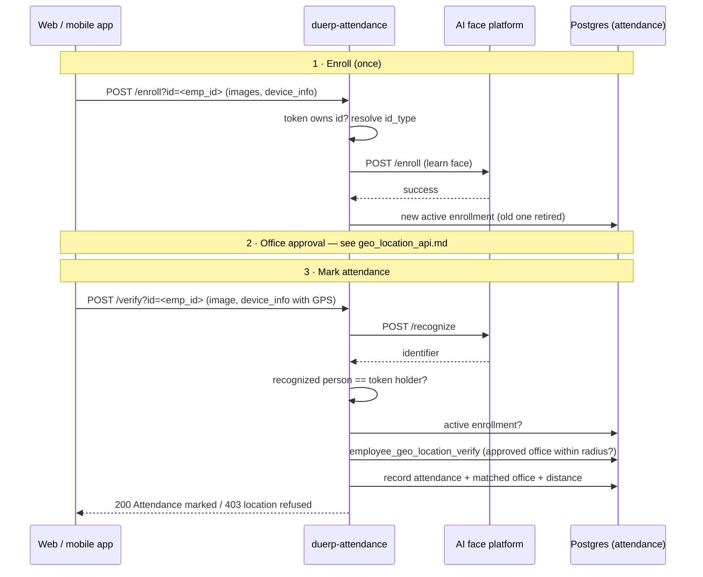

# Enroll & Mark Attendance API

Face enrollment and check-in, including the **approved-office location check** added with the office geo-location feature.

| | |
|---|---|
| Service | `duerp-attendance`, default `http://<host>:8083` |
| Source | `src/routes/wow_attendance.rs` (`wow_enroll`, `wow_verify`) |
| SQL | `sql/001_wow_attendance.sql`, `sql/010_employee_geo_location.sql` (schema `attendance`) |
| Related | Office selection & approval: [`geo_location_api.md`](geo_location_api.md) · Full module reference: [`wow_attendance.md`](wow_attendance.md) |

---

## 1. The flow

```
1. Enroll face            2. Get an office approved           3. Mark attendance
   POST …/enroll             POST /ext-api/geo-location/select    POST …/verify
   (once)                    + admin approves                     (every check-in)
                             (once per office, staff only)
```



**Students** enroll and check in with face only: no office selection, no location check.

---

## 2. Common rules

### 2.1 Headers

| Header | Required | Value |
|---|---|---|
| `X-App-Id` | yes | app ID (`EXT_APP_ID`) |
| `X-App-Password` | yes | app password (`EXT_APP_PASSWORD`) |
| `Authorization` | yes | `Bearer <token>` from `POST /login` |
| `Content-Type` | yes | `multipart/form-data` (let the client set the boundary) |

The caller's IP must also be allowed for the path in `attendance.ext_api_allowed_ips`.

### 2.2 Who you can enroll or check in

**Only yourself.** The person being enrolled, and the face recognized at check-in, must belong to the token holder. That means one of these is true:

- the ID equals the token's `sub` (the 10-digit `emp_id` for staff, or the DU `user_id` for students), **or**
- DU reports that employee's `user_id` equals the token's `sub`.

Otherwise the call returns `401`, and the attempt is recorded in `attendance.wow_attendance_token_mismatch_record`.

### 2.3 `device_info`

A **JSON string** sent as a form field. Location keys are read from it, and several spellings are accepted:

| Value | Accepted keys | Needed for |
|---|---|---|
| latitude | `device_lat` · `lat` · `latitude` | **employee check-in (required)** |
| longitude | `device_long` · `long` · `lng` · `longitude` | **employee check-in (required)** |
| GPS accuracy (m) | `accuracy_meters` · `accuracy` · `gps_accuracy` · `horizontal_accuracy` | optional; enforced when sent |
| anything else | e.g. `device`, `os`, `app_version` | stored with the record |

`0, 0` is treated as "no GPS fix", not as a location.

### 2.4 Images

| Rule | Value |
|---|---|
| Formats | JPEG, PNG, WEBP, BMP, HEIC/HEIF (checked by file content, not extension) |
| Largest accepted upload | `WOW_MAX_UPLOAD_MB` (default **25 MB**); larger → `413` |
| Sent to the AI platform | shrunk to fit `WOW_MAX_IMAGE_MB` (default **5 MB**) automatically |
| Tip | send JPEG. HEIC is accepted but can't be shrunk, so an oversized one fails at the AI platform. |

---

## 3. Enroll

```
POST /ext-api/wow-attendance/enroll?id={id}
```

Registers a person's face. Photos are saved, then sent to the AI platform to learn. **The enrollment is written to the database only after the AI platform confirms.** If the AI platform fails, the photos are deleted and nothing is saved.

Enrollment takes **no location**. The office is chosen separately (§1, step 2).

### 3.1 Request

| Part | Where | Required | Notes |
|---|---|---|---|
| `id` | query or form field | yes | the person's own ID: 10-digit `emp_id` for staff |
| `images` | form file(s) | yes | one or more face photos; **repeat the field** for each photo |
| `device_info` | form field | no | JSON string, e.g. `{"device":"Android","os":"14","app_version":"2.1.0"}` |
| `name` | form field | no | display name for the AI platform (defaults to `id`) |
| `X-Id-Type` | header | students | `Student` \| `Employee`, used only when DU doesn't confirm the ID is an employee |

`id_type` is **not** taken from the request. It is worked out in this order:

1. If DU confirms `id` is an employee, it is `Employee`.
2. Otherwise the `X-Id-Type` header is used.
3. Otherwise `WOW_IDTYPE_FALLBACK` is used.

**Students must send `X-Id-Type: Student`**, or they are recorded as whatever the fallback says.

When the "Match with EIS" setting is ON, student photos are also compared with the EIS studentship photo before enrolling.

### 3.2 Re-enrolling

Use the same endpoint. Each call creates a **new active enrollment** with only the photos from that call. The previous one is retired, not deleted, so its history is kept. `version` goes up by 1 each time, and `previous_enrollment_id` points back to the enrollment it replaced.

### 3.3 Example

```bash
curl -X POST "http://localhost:8083/ext-api/wow-attendance/enroll?id=1957103001" \
  -H "X-App-Id: $APP_ID" -H "X-App-Password: $APP_PASSWORD" \
  -H "Authorization: Bearer $TOKEN" \
  -F 'device_info={"device":"Android","os":"14","app_version":"2.1.0"}' \
  -F "images=@face1.jpg" \
  -F "images=@face2.jpg" \
  -F "images=@face3.jpg"
```

### 3.4 Responses

**200: enrolled**

```json
{
  "success": true,
  "message": "Enrolled successfully",
  "data": {
    "id": "1957103001",
    "id_type": "Employee",
    "enrolled_image_count": 3,
    "enrollment_id": "5b1c…",
    "version": 1,
    "is_reenrollment": false,
    "previous_enrollment_id": null
  },
  "ai_enrolled": true
}
```

When enrolling again, `message` is `"Re-enrolled successfully"`, `version` is 2 or higher, `is_reenrollment` is `true`, and `previous_enrollment_id` is set.

**Errors**

| HTTP | Body (`message` / `code`) | Cause |
|---|---|---|
| 400 | `` `id` is required (query param or form field) `` | no `id` |
| 400 | `Only image files are allowed …` | a file isn't an image |
| 400 | `id_type could not be determined — send an X-Id-Type …` | student without `X-Id-Type` and no fallback configured |
| 400 / 422 / 503 | `code`: `eis_face_mismatch` · `eis_no_image` · `eis_no_card` · `eis_match_unavailable` | Match with EIS refused a student enrollment |
| 401 | `Person mismatch. enroll id=<id> but Logged in User id=<sub>` | enrolling someone else (§2.2) |
| 401 | `Missing or empty token …` · `Invalid token` · `Token has expired` | token problem |
| 413 | `Each image must be at most 25 MB` | photo over the upload limit |
| 502 | `Face enrollment failed on the AI platform; nothing was saved` (+ `ai_error`) | AI platform down or refused; nothing was saved |

---

## 4. Mark attendance (verify)

```
POST /ext-api/wow-attendance/verify?id={id}
```

Takes a live selfie, identifies the person through the AI platform, checks their location (employees), and records attendance.

### 4.1 Request

| Part | Where | Required | Notes |
|---|---|---|---|
| `image` | form file | yes | the live photo. The field may also be named `images`, `file` or `photo`, and may be a base64 text field (a `data:image/…;base64,` prefix is fine). |
| `device_info` | form field | **employees: yes** | JSON string with GPS: `{"latitude":23.7241,"longitude":90.4004,"accuracy":12}` |
| `id` | query or form field | recommended | 1:1 guard. If the recognized face isn't this ID, the response is "Face did not match the requested person". Apps where the user is signed in should always send it. |
| `id_type` | query or form field | no | fallback only |

### 4.2 What the server checks, in order

| # | Check | Fails with |
|---|---|---|
| 1 | Token is valid | `401` |
| 2 | AI platform recognizes the face | `200` `success:false` "No matching enrolled person found" |
| 3 | Recognized person is the token holder (§2.2) | `401` "Person identified but mismatch …" |
| 4 | Recognized person is the requested `id` (if sent) | `200` `success:false` "Face did not match the requested person" |
| 5 | Person has an active enrollment | `200` `success:false` "Recognized person is not enrolled" |
| 6 | **Employees only:** GPS present | `400` "Device location is required …" |
| 7 | **Employees only:** location check (§4.3) | `403` with a `code` |
| 8 | Record the attendance | `200` "Attendance marked" |

> **A `200` is not always success.** Steps 2, 4 and 5 return `200` with `"success": false`. Always check `success` in the body.

### 4.3 The location check (employees)

The `GEO_LOCATION_MODE` setting (`attendance.system_settings`) decides which rule applies:

| Mode | Rule |
|---|---|
| `APPROVED_OFFICE_OR_BODY_MAPPING` *(current default)* | employees with **at least one APPROVED office** use the approved-office rule; everyone else uses the older body-mapping rule |
| `APPROVED_OFFICE` | approved-office rule for every employee; no approved office means no attendance |
| `BODY_MAPPING` | older rule only: the employee's HR office (`employees.office`) → `body_building_mapping` |

**Approved-office rule:**

1. If the device sent an accuracy worse than `GEO_MAX_GPS_ACCURACY_METERS` (default **50 m**), the check fails with `GPS_ACCURACY_TOO_LOW`.
2. Take the employee's offices that are **APPROVED** and whose location is **ACTIVE**. If there are none, the check fails with `NO_APPROVED_LOCATION`.
3. Measure the distance to each one and take the **nearest**.
4. If that distance is within the office's `radius_meters`, the check passes. Otherwise it fails with `OUT_OF_LOCATION`.

Every failure is logged in `attendance.geo_attendance_attempt_log`. On success, the attendance record stores `employee_geo_location_id`, `geo_location_office_id`, `latitude`, `longitude` and `distance_meters`.

`location.source` in the response says which rule decided: `APPROVED_OFFICE` or `BODY_MAPPING`.

### 4.4 Example

```bash
curl -X POST "http://localhost:8083/ext-api/wow-attendance/verify?id=1957103001" \
  -H "X-App-Id: $APP_ID" -H "X-App-Password: $APP_PASSWORD" \
  -H "Authorization: Bearer $TOKEN" \
  -F "image=@live.jpg" \
  -F 'device_info={"latitude":23.72410,"longitude":90.40041,"accuracy":12,"device":"Android","app_version":"2.1.0"}'
```

### 4.5 Responses

**200: attendance marked (approved office)**

```json
{
  "success": true,
  "matched": true,
  "message": "Attendance marked",
  "data": {
    "id": "1957103001",
    "id_type": "Employee",
    "attendance_id": "8b0f…",
    "matched_at": "2026-11-08T09:02:11+06:00",
    "confidence": 1.0
  },
  "location": {
    "source": "APPROVED_OFFICE",
    "mode": "APPROVED_OFFICE_OR_BODY_MAPPING",
    "emp_id": "1957103001",
    "employee_geo_location_id": 102,
    "geo_location_office_id": 4,
    "office_id": "490010",
    "office_name": "Office of the Controller of Examinations",
    "label": null,
    "distance_meters": 34.6,
    "radius_meters": 120
  }
}
```

When the older rule decides, `location` has `"source": "BODY_MAPPING"` and the fields `building_id`, `building_name`, `body_code`, `distance_m` and `radius_m`. Students get no `location`.

**403: location refused**

```json
{
  "success": false,
  "matched": true,
  "verified": false,
  "code": "OUT_OF_LOCATION",
  "message": "You are not inside any of your approved offices",
  "recognized_identifier": "1957103001",
  "location": {
    "source": "APPROVED_OFFICE",
    "office_name": "Office of the Controller of Examinations",
    "geo_location_office_id": 4,
    "distance_meters": 2410.3,
    "radius_meters": 120
  },
  "live_image": "/app/uploads/wow_attendance/live/….jpg"
}
```

| `code` | Meaning | What the app should tell the user |
|---|---|---|
| `OUT_OF_LOCATION` | outside every approved office; `location` names the nearest | "You're 2.4 km from <office> — you need to be within 120 m" |
| `NO_APPROVED_LOCATION` | no APPROVED office, or every approved one is INACTIVE | "Choose your office and wait for approval", with a link to the office selection screen |
| `GPS_ACCURACY_TOO_LOW` | reported accuracy is worse than the limit (`location.accuracy_meters`, `location.max_accuracy_meters`) | "Move outdoors / use your phone and try again" |
| `INVALID_COORDINATES` | latitude or longitude out of range | app bug |
| `LOCATION_NOT_VERIFIED` | older rule couldn't run: `Employee not found` · `Employee has no office assigned` · `No building mapping found …` | contact HR or the administrator |

**200, not marked** (check `success`)

```json
{ "success": false, "matched": false, "message": "No matching enrolled person found",
  "reason": "Face not recognized", "live_image": "…" }
```

```json
{ "success": false, "matched": false, "message": "Face did not match the requested person",
  "recognized_identifier": "1957100099", "live_image": "…" }
```

```json
{ "success": false, "matched": false, "message": "Recognized person is not enrolled",
  "recognized_identifier": "1957103001", "live_image": "…" }
```

**Other errors**

| HTTP | `message` | Cause |
|---|---|---|
| 400 | `A live face image is required` | no image part |
| 400 | `Invalid base64 image: …` · `Only image files are allowed …` | bad image |
| 400 | `Device location is required: send device_info as JSON containing device_lat and device_long` | employee without GPS (any key spelling from §2.3 works) |
| 401 | `Person identified but mismatch. face recognized as identifier=<x> but Logged in User id=<sub>` | someone else's face (§2.2) |
| 401 | `Missing or empty token …` · `Invalid token` · `Token has expired` | token problem |
| 413 | `Image must be at most 25 MB` | over the upload limit |
| 500 | `Face recognition failed its server: …` | AI platform unreachable or errored; safe to retry |
| 500 | `Could not determine id_type for the recognized person` | data problem |

---

## 5. Before an employee can check in

| Step | How | Doc |
|---|---|---|
| Office location exists and is ACTIVE | admin: `POST /ext-api/geo-location/offices/create` | [`geo_location_api.md` §3](geo_location_api.md#3-admin-office-geo-locations) |
| Face enrolled | `POST /ext-api/wow-attendance/enroll` | §3 above |
| Office selected | employee: `POST /ext-api/geo-location/select` | [`geo_location_api.md` §4](geo_location_api.md#4-employee-office-selection) |
| Selection approved | admin: `POST /ext-api/geo-location/requests/approve` (or `requests/assign`) | [`geo_location_api.md` §5](geo_location_api.md#5-admin-approvals) |

Order matters: **selecting an office requires an active enrollment** (`NOT_ENROLLED` otherwise). An admin's direct assign does not.

---

## 6. Settings

| Setting | Where | Default | Effect |
|---|---|---|---|
| `GEO_LOCATION_MODE` | `attendance.system_settings` | `APPROVED_OFFICE_OR_BODY_MAPPING` | which location rule `/verify` uses (§4.3) |
| `GEO_MAX_GPS_ACCURACY_METERS` | `attendance.system_settings` | `50` | worst accepted GPS accuracy, when the device reports it |
| `WOW_MAX_UPLOAD_MB` | `.env` | `25` | largest accepted photo |
| `WOW_MAX_IMAGE_MB` | `.env` | `5` | size photos are shrunk to for the AI platform |
| `WOW_IDTYPE_FALLBACK` | `.env` | — | `id_type` when DU doesn't confirm an employee and no `X-Id-Type` is sent |
| `WOW_ACCEPT_DU_TOKEN` | `.env` | `true` | still accept DU's own token (signature not verifiable); set `false` once all clients use `POST /login` |

Switch to the strict location rule when every employee's office is approved:

```sql
UPDATE attendance.system_settings SET value = 'APPROVED_OFFICE', updated_at = now()
 WHERE key = 'GEO_LOCATION_MODE';
```

---

## 7. Client checklist

- Send `Authorization: Bearer <token>` from `POST /login`, plus `X-App-Id` and `X-App-Password`.
- Enroll several clear, front-facing JPEG photos, with `images` repeated once per photo.
- On verify, always send `?id=<own id>` and `device_info` with `latitude`, `longitude` and `accuracy`.
- **Check `success` in the body**, not just the HTTP status.
- On a `403` from verify, branch on `code` and show `location.office_name` and the distance.
- Wait for a real GPS fix before enabling the capture button. Ignore `0,0`, and warn when accuracy is worse than 50 m.
- Browsers allow the camera and location only on **HTTPS or localhost**.
