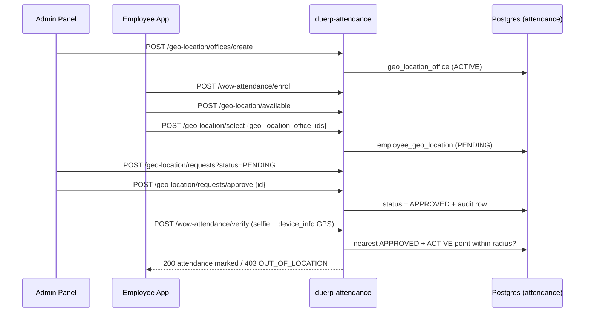
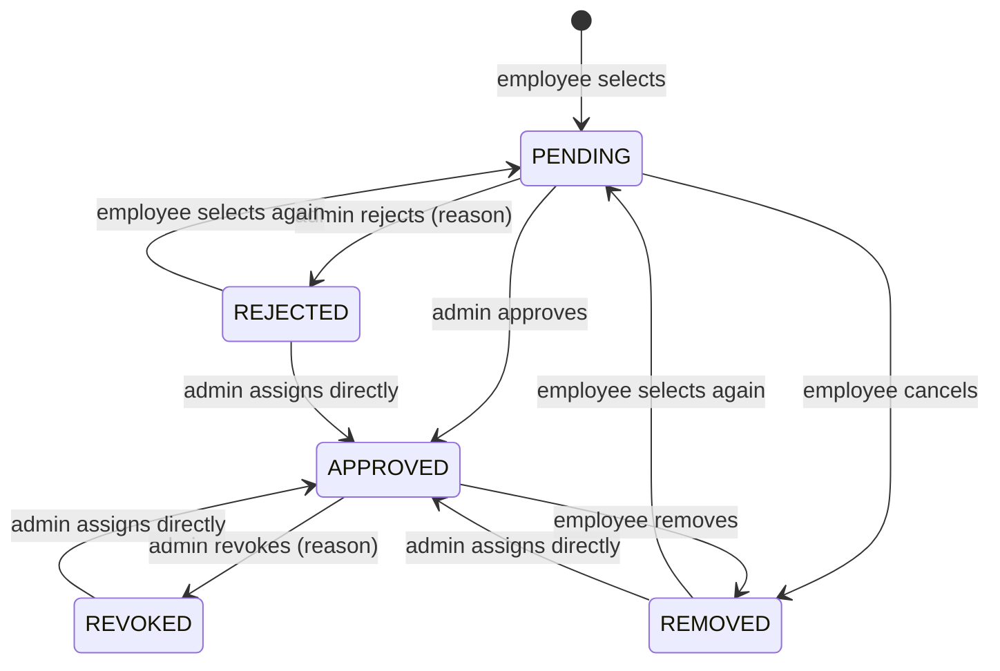

# Employee Office Geo-Location API

This API lets employees choose the offices they will mark attendance at, and lets admins approve those choices. Attendance itself is still marked through `POST /ext-api/wow-attendance/verify`. That endpoint now checks the employee's **approved** offices (see [§6](#6-attendance-check-in--location-gate)).

- **Design spec:** [`employee_attendance_face_api.md`](employee_attendance_face_api.md)
- **Source:** `src/routes/geo_location.rs`, plus the `/verify` gate in `src/routes/wow_attendance.rs`
- **SQL:** `sql/010_employee_geo_location.sql` (schema `attendance`)
- **Tests:** `tests/employee_geo_location_sql.rs`
- **Base URL:** `http://<host>:8083` (`ATTENDANCE_PORT`)

---

## Contents

1. [Overview & flow](#1-overview--flow)
2. [Conventions](#2-conventions)
3. [Admin: office geo-locations](#3-admin-office-geo-locations)
4. [Employee: office selection](#4-employee-office-selection)
5. [Admin: approvals](#5-admin-approvals)
6. [Attendance check-in (location gate)](#6-attendance-check-in--location-gate)
7. [Error codes](#7-error-codes)
8. [Settings](#8-settings)
9. [Data model](#9-data-model)
10. [Setup checklist](#10-setup-checklist)

---

## 1. Overview & flow

| # | Step | Who | Endpoint |
|---|------|-----|----------|
| 0 | Add geo points (lat/long/radius) to an office | Admin | `/ext-api/geo-location/offices/create` |
| 1 | Enroll face (no location) | Employee | `/ext-api/wow-attendance/enroll` *(existing)* |
| 2 | List selectable offices | Employee | `/ext-api/geo-location/available` |
| 3 | Select one or more offices → `PENDING` | Employee | `/ext-api/geo-location/select` |
| 4 | Approve / reject | Admin | `/ext-api/geo-location/requests/approve` · `/reject` |
| 5 | Mark attendance (face + GPS) | Employee | `/ext-api/wow-attendance/verify` *(existing)* |



**Core rule.** Attendance is recorded only when both of these hold:

- The face is recognized as the token holder.
- The device is inside the radius of at least one office point that is **ACTIVE** and whose selection is **APPROVED** for that employee.

### Selection status lifecycle



---

## 2. Conventions

### 2.1 Headers (every call)

| Header | Value |
|--------|-------|
| `X-App-Id` | App ID (`EXT_APP_ID`) |
| `X-App-Password` | App password (`EXT_APP_PASSWORD`) |
| `Authorization` | `Bearer <token>` from `POST /login` |
| `Content-Type` | `application/json` (calls that have a body) |

### 2.2 Method and paths

Every endpoint is **`POST` on a fixed path**. IDs go in the JSON body, and list filters go in the query string. The gateway matches the IP allow-list and the permission map on the exact path, so paths like `/{id}/approve` are not used.

### 2.3 Who can call what

| Group | Permission | Identity |
|-------|------------|----------|
| Admin: office points (§3) | `attendance.geo.manage` | the token is the acting admin |
| Admin: approvals (§5) | `attendance.geo.review` | the token is the acting admin |
| Employee (§4) | any logged-in employee | **the employee is taken from the token's `sub`**. There is no `employee_id` parameter, so an employee can only see or change their own selections. |

Both admin permissions are granted to the `admin` and `superadmin` roles. Admin endpoints always enforce them, whatever `EXT_ACCESS_CONTROL` is set to.

### 2.4 Response envelope

Success:

```json
{ "status": "success", "message": "…", "data": { } }
```

Failure:

```json
{ "status": "failed", "code": "ALREADY_SELECTED", "message": "…", "data": { } }
```

Branch on `code`, which is stable. `message` is human-readable and may change. The HTTP status for each code is listed in [§7](#7-error-codes).

### 2.5 Errors raised before the handler runs

| HTTP | Body | Cause |
|------|------|-------|
| 401 | `{"error": "Invalid App ID or Password"}` | bad or missing `X-App-*` headers |
| 403 | `{"error": "IP address not allowed for this endpoint. …"}` | no allow-list row for the path |
| 401 | `{"success": false, "message": "Missing or empty token. …"}` | no bearer token |
| 401 | `{"success": false, "message": "Token has expired"}` / `"Invalid token"` | bad token |
| 400 | `{"success": false, "code": "invalid_json", "message": "Invalid JSON body: missing field `id` …"}` | body is malformed or missing a required field |
| 400 | `{"success": false, "code": "invalid_content_type", …}` | the body was not sent as `application/json` |
| 403 | `{"status": "failed", "code": "FORBIDDEN", "message": "You do not have permission to manage office geo-locations"}` | admin endpoint called without the permission |

### 2.6 The objects

**Office point** (`geo_location_office`):

```json
{
  "id": 4,
  "office_id": "490010",
  "office_name": "Office of the Controller of Examinations",
  "label": "Annex building",
  "latitude": 23.7240320,
  "longitude": 90.4003580,
  "radius_meters": 120,
  "status": "ACTIVE",
  "created_by": "1957103001",
  "created_at": "2026-11-08T10:10:55.924281+06:00",
  "updated_at": "2026-11-08T10:10:55.924281+06:00"
}
```

- `office_id` is the office's **body code** (`ictcell.body.body_code`, the same value as `employees.office`).
- `office_name` is `ictcell.body.name`.
- `label` is optional. Use it to tell apart several points that belong to one office.

**Selection** (`employee_geo_location`):

```json
{
  "id": 102,
  "employee_id": "1957103001",
  "employee_name": "Rahim Uddin",
  "designation": "Section Officer",
  "department": "Department of English",
  "geo_location_office_id": 4,
  "office_id": "490010",
  "office_name": "Office of the Controller of Examinations",
  "label": "Annex building",
  "latitude": 23.724032,
  "longitude": 90.400358,
  "radius_meters": 120,
  "office_status": "ACTIVE",
  "status": "PENDING",
  "requested_at": "2026-11-08T09:16:00+06:00",
  "reviewed_by": null,
  "reviewed_at": null,
  "review_note": null
}
```

- `office_status` is the status of the office point. `status` is the status of the selection.
- `department` is the name of the employee's own office.
- Employee endpoints leave out `employee_name`, `designation` and `department`.

---

## 3. Admin: office geo-locations

Permission: `attendance.geo.manage`.

### 3.1 List office points

```
POST /ext-api/geo-location/offices?office_id=490010&status=ACTIVE
```

| Query | Required | Notes |
|-------|----------|-------|
| `office_id` | no | body code |
| `status` | no | `ACTIVE` \| `INACTIVE`; returns all when omitted |

**200**: an array of office points, each with two extra counts:

```json
{
  "status": "success",
  "message": "OK",
  "data": [
    {
      "id": 4,
      "office_id": "490010",
      "office_name": "Office of the Controller of Examinations",
      "label": null,
      "latitude": 23.724032,
      "longitude": 90.400358,
      "radius_meters": 120,
      "status": "ACTIVE",
      "created_by": "1957103001",
      "created_at": "…",
      "updated_at": "…",
      "approved_employees": 18,
      "pending_employees": 3
    }
  ]
}
```

### 3.2 Create an office point

```
POST /ext-api/geo-location/offices/create
```

```json
{
  "office_id": "490010",
  "latitude": 23.724032,
  "longitude": 90.400358,
  "radius_meters": 120,
  "status": "ACTIVE",
  "label": "Annex building"
}
```

| Field | Type | Required | Rule |
|-------|------|----------|------|
| `office_id` | string | yes | must exist in `ictcell.body.body_code` |
| `latitude` | number | yes | −90 to 90 (stored to 7 decimal places) |
| `longitude` | number | yes | −180 to 180 |
| `radius_meters` | integer | no | 30 to 1000, default **100** |
| `status` | string | no | `ACTIVE` (default) \| `INACTIVE` |
| `label` | string | no | free text |

An office can have more than one point, for example two buildings on one campus.

**201**: `data` is the new office point.

**Errors:** `INVALID_INPUT` (400), `OFFICE_NOT_FOUND` (404).

### 3.3 Update an office point

```
POST /ext-api/geo-location/offices/update
```

```json
{ "id": 4, "latitude": 23.72405, "longitude": 90.40031, "radius_meters": 150 }
```

| Field | Required | Notes |
|-------|----------|-------|
| `id` | yes | |
| `latitude`, `longitude`, `radius_meters`, `label` | at least one | an omitted field is left unchanged; `"label": ""` clears the label |

Moving a point affects every employee linked to it. The response includes `linked_employees`, the number of PENDING and APPROVED selections on the point, so the UI can show it in the confirmation step. Every change is written to `geo_location_office_audit` with the old and new values.

**200**: the updated office point plus `"linked_employees": 18`.

**Errors:** `INVALID_INPUT` (400), `NOT_FOUND` (404).

### 3.4 Activate / deactivate

```
POST /ext-api/geo-location/offices/status
```

```json
{ "id": 4, "status": "INACTIVE" }
```

- **INACTIVE**: the point is hidden from selection, and **check-ins at this point are blocked for everyone**, including employees whose selection is APPROVED. Their selections stay APPROVED and start working again when the point is reactivated.
- The response includes `approved_employees`, the people to notify.

**200**:

```json
{
  "status": "success",
  "message": "Office geo-location set INACTIVE",
  "data": { "id": 4, "status": "INACTIVE", "…": "…", "approved_employees": 18 }
}
```

If the point already has that status, the message reads `"Already INACTIVE"`.

**Errors:** `INVALID_INPUT` (400), `NOT_FOUND` (404).

---

## 4. Employee: office selection

These endpoints need only a valid employee token. The employee ID always comes from the token.

### 4.1 Offices available to select

```
POST /ext-api/geo-location/available
```

Returns only **ACTIVE** points.

**200**:

```json
{
  "status": "success",
  "message": "OK",
  "data": [
    { "id": 1, "office_id": "440000", "office_name": "Registrar Office", "label": null,
      "latitude": 23.7340, "longitude": 90.3928, "radius_meters": 100 },
    { "id": 4, "office_id": "490010", "office_name": "Office of the Controller of Examinations", "label": "Annex building",
      "latitude": 23.724032, "longitude": 90.400358, "radius_meters": 120 }
  ]
}
```

### 4.2 Select offices (one or more)

```
POST /ext-api/geo-location/select
```

```json
{ "geo_location_office_ids": [1, 4] }
```

How the request is handled:

- Duplicate IDs in the request are merged.
- IDs that are already PENDING or APPROVED are skipped.
- A selection that was previously REJECTED or REMOVED goes back to **PENDING**.
- Nothing is saved unless every ID passes validation.

**201**: the new or re-requested selections, all `PENDING`:

```json
{
  "status": "success",
  "message": "Office selection sent for admin approval",
  "data": [
    { "id": 101, "employee_id": "1957103001", "geo_location_office_id": 1, "office_name": "Registrar Office", "status": "PENDING", "…": "…" },
    { "id": 102, "employee_id": "1957103001", "geo_location_office_id": 4, "office_name": "Office of the Controller of Examinations", "status": "PENDING", "…": "…" }
  ]
}
```

| HTTP | Code | When |
|------|------|------|
| 400 | `INVALID_INPUT` | empty list, or more than 50 IDs |
| 404 | `EMPLOYEE_NOT_FOUND` | the token holder is not in `employees` |
| 404 | `NOT_ENROLLED` | no active Employee face enrollment; enroll first |
| 404 | `GEO_LOCATION_OFFICE_NOT_FOUND` | an ID does not exist or is INACTIVE (`data.geo_location_office_id` names it) |
| 409 | `ALREADY_SELECTED` | every ID is already PENDING or APPROVED |
| 409 | `OFFICE_REVOKED` | an admin revoked this office; only an admin can assign it again |
| 422 | `LOCATION_LIMIT_EXCEEDED` | PENDING + APPROVED would exceed the limit (default 5); `data` has `max` and `current` |

### 4.3 My offices

```
POST /ext-api/geo-location/my
```

Returns every selection except REMOVED ones, newest first.

**200**:

```json
{
  "status": "success",
  "message": "OK",
  "data": [
    { "id": 102, "geo_location_office_id": 4, "office_name": "Office of the Controller of Examinations", "office_status": "ACTIVE",
      "status": "PENDING", "requested_at": "…", "reviewed_at": null, "review_note": null, "…": "…" },
    { "id": 101, "geo_location_office_id": 1, "office_name": "Registrar Office", "office_status": "ACTIVE",
      "status": "APPROVED", "reviewed_at": "…", "review_note": "Branch staff", "…": "…" }
  ]
}
```

To show "approved but currently unavailable", use `status = APPROVED` together with `office_status = INACTIVE`.

### 4.4 Remove / cancel

```
POST /ext-api/geo-location/remove
```

```json
{ "id": 102 }
```

Sets the selection to `REMOVED`. This works on PENDING (cancel) or APPROVED (remove) selections.

**200**: `data` is the selection with `"status": "REMOVED"`.

| HTTP | Code | When |
|------|------|------|
| 404 | `NOT_FOUND` | no such selection, **or it belongs to someone else** |
| 409 | `INVALID_STATUS_TRANSITION` | already REJECTED, REVOKED or REMOVED |

---

## 5. Admin: approvals

Permission: `attendance.geo.review`.

### 5.1 List requests

```
POST /ext-api/geo-location/requests?status=PENDING&office_id=490010&search=Rahim&page=1&limit=20
```

| Query | Default | Notes |
|-------|---------|-------|
| `status` | `PENDING` | `PENDING` \| `APPROVED` \| `REJECTED` \| `REVOKED` \| `REMOVED` \| `ALL` |
| `office_id` | – | body code of the office point |
| `employee_id` | – | exact match; use it for the "Employee offices" screen together with `status=ALL` |
| `search` | – | employee-ID prefix, or a substring of the name |
| `page` | 1 | |
| `limit` | 20 | at most 100 |

Results are sorted oldest request first, so the queue is handled in order.

**200**:

```json
{
  "status": "success",
  "message": "OK",
  "data": {
    "items": [
      {
        "id": 102,
        "employee_id": "1957103001",
        "employee_name": "Rahim Uddin",
        "designation": "Section Officer",
        "department": "Department of English",
        "geo_location_office_id": 4,
        "office_id": "490010",
        "office_name": "Office of the Controller of Examinations",
        "label": null,
        "latitude": 23.724032,
        "longitude": 90.400358,
        "radius_meters": 120,
        "office_status": "ACTIVE",
        "status": "PENDING",
        "requested_at": "2026-11-08T09:16:00+06:00",
        "reviewed_by": null,
        "reviewed_at": null,
        "review_note": null
      }
    ],
    "total": 1,
    "page": 1,
    "limit": 20
  }
}
```

### 5.2 Approve

```
POST /ext-api/geo-location/requests/approve
```

```json
{ "id": 102, "note": "Branch staff" }
```

`note` is optional. Only **PENDING** selections can be approved, and the office point must be **ACTIVE**.

**200**:

```json
{ "status": "success", "message": "Office selection approved", "data": { "id": 102, "status": "APPROVED", "reviewed_by": "1957103001", "reviewed_at": "…", "review_note": "Branch staff", "…": "…" } }
```

### 5.3 Reject

```
POST /ext-api/geo-location/requests/reject
```

```json
{ "id": 102, "reason": "Not posted at this office" }
```

`reason` is **required** and must be 3 to 255 characters. Only **PENDING** selections can be rejected. The employee can select the same office again later.

### 5.4 Revoke

```
POST /ext-api/geo-location/requests/revoke
```

```json
{ "id": 101, "reason": "Transferred to Chattogram" }
```

`reason` is **required**. Only **APPROVED** selections can be revoked. The employee **cannot** re-request a revoked office; only an admin can restore it with direct assign ([§5.6](#56-direct-assign)).

**Errors for approve, reject and revoke:**

| HTTP | Code | When |
|------|------|------|
| 404 | `NOT_FOUND` | no such selection |
| 409 | `INVALID_STATUS_TRANSITION` | wrong current status, e.g. approving a REJECTED selection (`data.status` gives the current status) |
| 409 | `GEO_LOCATION_OFFICE_INACTIVE` | approving a selection whose office point is INACTIVE |
| 422 | `REASON_REQUIRED` | reject or revoke without a reason of at least 3 characters |
| 400 | `INVALID_INPUT` | note longer than 255 characters |

### 5.5 Bulk review

```
POST /ext-api/geo-location/requests/bulk-review
```

```json
{ "action": "APPROVE", "ids": [102, 107, 111], "note": "Branch staff" }
```

| Field | Notes |
|-------|-------|
| `action` | `APPROVE` \| `REJECT` \| `REVOKE` |
| `ids` | 1 to 200 IDs; duplicates are merged |
| `note` / `reason` | either name is accepted; **required** for REJECT and REVOKE |

Each ID is reviewed independently, so one bad ID does not undo the others. The call returns **200** with the outcome for each ID:

```json
{
  "status": "success",
  "message": "2 reviewed, 1 failed",
  "data": {
    "succeeded": [ { "id": 102, "status": "APPROVED", "…": "…" }, { "id": 107, "status": "APPROVED", "…": "…" } ],
    "failed":    [ { "id": 111, "code": "INVALID_STATUS_TRANSITION", "message": "Cannot approve a REJECTED selection (only PENDING)" } ]
  }
}
```

A missing reason fails the whole call with `REASON_REQUIRED` (422) before any ID is processed.

### 5.6 Direct assign

```
POST /ext-api/geo-location/requests/assign
```

```json
{ "employee_id": "1957103001", "geo_location_office_id": 4, "note": "Posted by HR order 12/2026" }
```

- Creates the selection as **APPROVED** straight away.
- If a selection already exists in any other status, including REVOKED, it is set to APPROVED.
- The employee must exist in `employees` but **does not need to be enrolled yet**, so staff can be set up in advance.
- The per-employee limit is not applied, because it only limits self-service.

**201**: `data` is the selection with `"status": "APPROVED"`.

| HTTP | Code | When |
|------|------|------|
| 404 | `EMPLOYEE_NOT_FOUND` | unknown `employee_id` |
| 404 | `GEO_LOCATION_OFFICE_NOT_FOUND` | point does not exist or is INACTIVE |
| 409 | `ALREADY_SELECTED` | already APPROVED |

### 5.7 History of a selection

```
POST /ext-api/geo-location/requests/history
```

```json
{ "id": 101 }
```

**200**:

```json
{
  "status": "success",
  "message": "OK",
  "data": {
    "selection": { "id": 101, "status": "APPROVED", "…": "…" },
    "history": [
      { "action": "REQUEST", "old_status": null,       "new_status": "PENDING",  "actor_id": "1957103001", "note": null,           "created_at": "…" },
      { "action": "APPROVE", "old_status": "PENDING",  "new_status": "APPROVED", "actor_id": "1957100001", "note": "ok",           "created_at": "…" },
      { "action": "REVOKE",  "old_status": "APPROVED", "new_status": "REVOKED",  "actor_id": "1957100001", "note": "Transferred",  "created_at": "…" },
      { "action": "ASSIGN",  "old_status": "REVOKED",  "new_status": "APPROVED", "actor_id": "1957100001", "note": "Back",         "created_at": "…" }
    ]
  }
}
```

`action` is one of `REQUEST`, `APPROVE`, `REJECT`, `REVOKE`, `REMOVE` or `ASSIGN`. `actor_id` is the employee for REQUEST and REMOVE, and the admin for the other actions.

**Errors:** `NOT_FOUND` (404).

---

## 6. Attendance check-in: location gate

The endpoint is unchanged: `POST /ext-api/wow-attendance/verify` (multipart). See [`wow_attendance.md`](wow_attendance.md). The location check runs for **Employees only**, after the face is recognized and before the attendance record is written.

### 6.1 Location fields in `device_info`

`device_info` is a JSON string sent as a multipart field:

```json
{ "device_lat": 23.72410, "device_long": 90.40041, "accuracy_meters": 12.5 }
```

| Value | Accepted keys | Required |
|-------|---------------|----------|
| latitude | `device_lat` \| `lat` \| `latitude` | yes; a missing value is a 400 |
| longitude | `device_long` \| `long` \| `lng` \| `longitude` | yes |
| GPS accuracy (m) | `accuracy_meters` \| `accuracy` \| `gps_accuracy` \| `horizontal_accuracy` | no; checked only when sent |

### 6.2 Which rule applies: `GEO_LOCATION_MODE`

| Mode | Behaviour |
|------|-----------|
| `BODY_MAPPING` | old rule only (`employees.office` → `body_building_mapping`) |
| `APPROVED_OFFICE_OR_BODY_MAPPING` *(default)* | the approved-office rule for employees with at least one APPROVED selection; the old rule for everyone else |
| `APPROVED_OFFICE` | approved-office rule only; an employee with nothing approved cannot check in |

`location.source` in the response tells you which rule decided: `APPROVED_OFFICE` or `BODY_MAPPING`.

### 6.3 Approved-office rule

1. If the device reports its accuracy and it is above `GEO_MAX_GPS_ACCURACY_METERS` (default 50), the check fails with `GPS_ACCURACY_TOO_LOW`.
2. Load the points that are **APPROVED** for this employee **and ACTIVE**. If there are none, the check fails with `NO_APPROVED_LOCATION`.
3. Compute the haversine distance to each point and take the **nearest**.
4. If that distance is within its `radius_meters`, the check passes. Otherwise it fails with `OUT_OF_LOCATION`.

Each failure is logged in `attendance.geo_attendance_attempt_log`. On success, the attendance record stores `employee_geo_location_id`, `geo_location_office_id`, `latitude`, `longitude` and `distance_meters`.

### 6.4 Success (200)

```json
{
  "success": true,
  "matched": true,
  "message": "Attendance marked",
  "data": {
    "id": "1957103001",
    "id_type": "Employee",
    "attendance_id": "8b0f…",
    "matched_at": "2026-11-08T09:02:11+06:00",
    "confidence": 1.0
  },
  "location": {
    "source": "APPROVED_OFFICE",
    "mode": "APPROVED_OFFICE_OR_BODY_MAPPING",
    "emp_id": "1957103001",
    "employee_geo_location_id": 102,
    "geo_location_office_id": 4,
    "office_id": "490010",
    "office_name": "Office of the Controller of Examinations",
    "label": null,
    "distance_meters": 34.6,
    "radius_meters": 120
  }
}
```

When `source` is `BODY_MAPPING`, `location` has the older shape: `building_id`, `building_name`, `distance_m`, `radius_m`, `body_code`.

### 6.5 Location refused (403)

```json
{
  "success": false,
  "matched": true,
  "verified": false,
  "code": "OUT_OF_LOCATION",
  "message": "You are not inside any of your approved offices",
  "recognized_identifier": "1957103001",
  "location": {
    "source": "APPROVED_OFFICE",
    "office_name": "Office of the Controller of Examinations",
    "geo_location_office_id": 4,
    "distance_meters": 2410.3,
    "radius_meters": 120,
    "…": "…"
  },
  "live_image": "…"
}
```

| `code` | Meaning | Suggested app message |
|--------|---------|-----------------------|
| `OUT_OF_LOCATION` | outside every approved point; `location` shows the nearest one | "You are {distance} m from {office_name}" |
| `NO_APPROVED_LOCATION` | nothing approved, or every approved point is INACTIVE | "Select your office and wait for approval" |
| `GPS_ACCURACY_TOO_LOW` | reported accuracy exceeds the limit (`location.accuracy_meters`, `location.max_accuracy_meters`) | "Move outdoors and try again" |
| `INVALID_COORDINATES` | coordinates out of range | – |
| `LOCATION_NOT_VERIFIED` | old rule could not run (no office, or no building mapping) | – |

---

## 7. Error codes

| HTTP | Code | Endpoints |
|------|------|-----------|
| 400 | `INVALID_INPUT` | any endpoint, for validation failures |
| 403 | `FORBIDDEN` | admin endpoints without the permission |
| 404 | `NOT_FOUND` | update, status, remove, review, history |
| 404 | `OFFICE_NOT_FOUND` | offices/create |
| 404 | `EMPLOYEE_NOT_FOUND` | select, assign |
| 404 | `NOT_ENROLLED` | select |
| 404 | `GEO_LOCATION_OFFICE_NOT_FOUND` | select, assign |
| 409 | `ALREADY_SELECTED` | select, assign |
| 409 | `OFFICE_REVOKED` | select |
| 409 | `INVALID_STATUS_TRANSITION` | remove, approve, reject, revoke |
| 409 | `GEO_LOCATION_OFFICE_INACTIVE` | approve |
| 422 | `LOCATION_LIMIT_EXCEEDED` | select |
| 422 | `REASON_REQUIRED` | reject, revoke, bulk-review |
| 500 | `INTERNAL_ERROR` | database failure |
| 403 | `OUT_OF_LOCATION` · `NO_APPROVED_LOCATION` · `GPS_ACCURACY_TOO_LOW` · `INVALID_COORDINATES` · `LOCATION_NOT_VERIFIED` | `/wow-attendance/verify` |

---

## 8. Settings

These are rows in `attendance.system_settings`. They are read on every call, so changes take effect immediately without a restart.

| Key | Default | Meaning |
|-----|---------|---------|
| `GEO_LOCATION_MODE` | `APPROVED_OFFICE_OR_BODY_MAPPING` | which rule `/verify` uses (§6.2); an unknown value is treated as the default |
| `GEO_MAX_ACTIVE_LOCATIONS` | `5` | maximum PENDING + APPROVED selections per employee (self-service only) |
| `GEO_MAX_GPS_ACCURACY_METERS` | `50` | reject worse accuracy when the device reports it |

```sql
-- after approvals are done: switch to the strict spec rule
UPDATE attendance.system_settings SET value = 'APPROVED_OFFICE', updated_at = now()
 WHERE key = 'GEO_LOCATION_MODE';
```

---

## 9. Data model

All tables are in the `attendance` schema.

| Table | Purpose |
|-------|---------|
| `geo_location_office` | `id`, `office_id` (body code), `label`, `latitude`, `longitude`, `radius_meters` (30–1000), `status` (ACTIVE/INACTIVE), `created_by`, `created_at`, `updated_at` |
| `employee_geo_location` | `id`, `employee_id`, `geo_location_office_id` → `geo_location_office.id`, `status`, `requested_at`, `reviewed_by`, `reviewed_at`, `review_note`; UNIQUE (`employee_id`, `geo_location_office_id`) |
| `employee_geo_location_audit` | one row per REQUEST / APPROVE / REJECT / REVOKE / REMOVE / ASSIGN |
| `geo_location_office_audit` | one row per CREATE / UPDATE / STATUS, with old and new values as JSON |
| `geo_attendance_attempt_log` | failed location checks: code, nearest point, distance, coordinates, accuracy |
| `wow_attendance_records` (+ columns) | `employee_geo_location_id`, `geo_location_office_id`, `latitude`, `longitude`, `distance_meters` |

All logic lives in SQL functions, so a `psql` caller gets the same answers as the API:

| Function | Used by |
|----------|---------|
| `geo_office_list` · `geo_office_create` · `geo_office_update` · `geo_office_set_status` | §3 |
| `geo_office_available` · `employee_geo_select` · `employee_geo_my` · `employee_geo_remove` | §4 |
| `employee_geo_requests` · `employee_geo_review` · `employee_geo_bulk_review` · `employee_geo_assign` · `employee_geo_history` | §5 |
| `employee_geo_location_verify` · `wow_attendance_record_location` | §6 |

---

## 10. Setup checklist

1. Apply the migration (idempotent):

   ```bash
   psql "$DATABASE_URL" -f sql/010_employee_geo_location.sql
   ```

2. Deploy and restart the service so the new routes are served.
3. Give the people who administer this an admin role:

   ```sql
   UPDATE attendance.app_users
      SET role_id = (SELECT id FROM attendance.roles WHERE key = 'admin')
    WHERE person_id = <emp_id>;
   ```

4. Create office points (§3.2). Employees then select (§4.2) and admins approve (§5.2).
5. When approvals are complete, set `GEO_LOCATION_MODE = APPROVED_OFFICE` (§8).

### Quick test with curl

```bash
H=(-H "X-App-Id: $EXT_APP_ID" -H "X-App-Password: $EXT_APP_PASSWORD" \
   -H "Authorization: Bearer $TOKEN" -H "Content-Type: application/json")

curl -X POST "${H[@]}" http://localhost:8083/ext-api/geo-location/available
curl -X POST "${H[@]}" http://localhost:8083/ext-api/geo-location/select \
     -d '{"geo_location_office_ids":[4]}'
curl -X POST "${H[@]}" "http://localhost:8083/ext-api/geo-location/requests?status=PENDING"
curl -X POST "${H[@]}" http://localhost:8083/ext-api/geo-location/requests/approve \
     -d '{"id":102,"note":"ok"}'
```

### Not implemented yet

- Notifications to employees and admins when a selection is approved, rejected or revoked, or a point is deactivated. The responses include the counts needed to drive them.
- CHECK_IN / CHECK_OUT typing, `ALREADY_MARKED` and `DEVICE_MISMATCH`. `/verify` records every successful check-in, as it did before.
